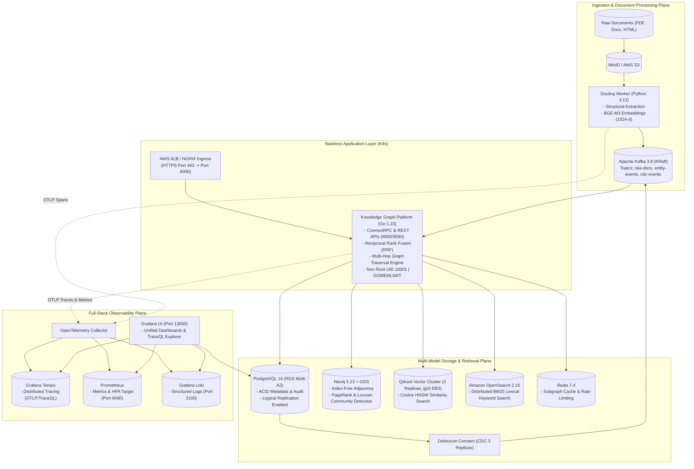

# Enterprise Knowledge Graph Platform

An enterprise-grade, failure-bounded, polyglot microservice platform delivering sub-second hybrid **GraphRAG**, multi-hop graph analytics, and real-time Change Data Capture (CDC).

---

## ── TECHNOLOGY STACK ARCHITECTURE ──────────────────────────────────────────

| Layer | Technology | Version | Primary Responsibility | Key Decision Rationale |
| :--- | :--- | :--- | :--- | :--- |
| **API & Core Engine** | **Go** | `1.23.2` | ConnectRPC, REST API, Graph Traversal Engine, RRF Fusion | Sub-millisecond latency, minimal runtime overhead (`GOMEMLIMIT`), native non-root UID 10001 container hardening. |
| **Document Ingestion** | **Python (Docling)** | `3.12` | Layout analysis, PDF/Docx/HTML table extraction, BGE-M3 embeddings | Isolated in worker containers to prevent PyTorch/CUDA memory pressure from starving API request threads. |
| **Embedding Model** | **BAAI BGE-M3** | `v1.5` | Dense (1024-d), multi-lingual semantic vector representation | Superior multi-lingual representation, long context support, dense semantic retrieval. |
| **Graph Database** | **Neo4j + GDS** | `5.23.0` | Property graph, Cypher queries, PageRank, Louvain community detection | Native index-free adjacency. GDS plugin provides in-memory parallel graph data science algorithms. |
| **Relational Database**| **PostgreSQL** | `16.4` | System metadata, tenant configuration, ACID audit trail, logical CDC | Strict foreign keys, ACID compliance, native logical replication write-ahead log (`wal_level=logical`). |
| **Change Data Capture**| **Debezium Connect** | `2.7.3` | Non-blocking WAL log tailing from PostgreSQL to Kafka topics | Eliminates dual-write inconsistencies. Synchronizes relational state mutations to graph and vector stores atomically. |
| **Event Streaming** | **Apache Kafka** | `3.8.0` | Event-driven graph updates, high-throughput replayable message bus | KRaft consensus (ZooKeeper-free), partition-ordered delivery, consumer group autoscaling. |
| **Vector Engine** | **Qdrant** | `1.12.1` | Dense HNSW vector search, payload filtering, cosine distance | Written in Rust. Fast concurrent vector similarity queries with payload-based filtering. |
| **Search Engine** | **OpenSearch** | `2.16.0` | Distributed BM25 lexical text retrieval, fuzzy keyword lookup | Open-source enterprise search. Combined with Qdrant via Reciprocal Rank Fusion (RRF) for hybrid retrieval. |
| **Cache & Governance** | **Redis** | `7.4` | Subgraph query caching, API rate limiting, distributed locking | Multi-model in-memory caching with sub-millisecond retrieval and TTL expiration. |
| **Object Storage** | **AWS S3 / MinIO** | `RELEASE.2024` | Raw document blob storage, database backup dump targets | S3-compatible API, multi-part parallel upload, server-side KMS encryption. |
| **Observability (Traces)**| **Grafana Tempo** | `2.6.1` | High-volume distributed tracing via OTLP (gRPC: 4317, HTTP: 4318) | Single-binary and distributed backend for TraceQL queries. Correlates directly to Loki logs via `trace_id`. |
| **Observability (Logs)**| **Grafana Loki** | `3.1.1` | Structured log aggregation with label indexing | Cost-effective log streaming indexed by labels (`job`, `service_name`, `environment`) and queryable via LogQL. |
| **Observability (Metrics)**| **Prometheus** | `2.54.1` | Time-series metrics collection, scrape targets, HPA scaling metric | Standard pull-based metric scraping with `/metrics` endpoints and PromQL alerting rules. |
| **Observability (UI)** | **Grafana** | `11.2.0` | Single pane of glass for dashboards, trace inspection, and log exploration | Pre-provisioned datasources (Prometheus, Loki, Tempo, PostgreSQL) with pre-configured Trace-to-Log jump buttons. |
| **Container Engine** | **Docker** | `24+` | Local multi-stage development, Air live-reload, Compose stack | Multi-stage builder stages, tini init processes, and non-root user execution (`UID 10001`). |
| **Container Orchestration**| **Kubernetes (EKS/KinD)**| `1.30.0` | Production workload hosting, autoscaling (HPA), PDBs, rolling updates | Industry standard declarative workload orchestration with zero-downtime rolling deploys. |
| **GitOps Delivery** | **Argo CD** | `v2.12` | Automated declarative GitOps reconciliation from Git to cluster | Automated sync, self-healing, pruning, drift detection, and canary rollouts. |
| **Secrets Management** | **External Secrets Operator**| `v0.9` | AWS Secrets Manager integration via IAM Roles for Service Accounts | Zero plaintext credentials in Git. Reconciles production secrets dynamically into Kubernetes memory. |
| **Persistent Storage** | **AWS EBS gp3 CSI**| `v1.35` | High-performance SSD storage for stateful workloads | 3000 IOPS baseline, 125 MB/s throughput, volume expansion enabled, KMS encryption at rest. |
| **Infrastructure as Code**| **Terraform** | `1.9+` | Modular cloud infrastructure (AWS EKS, RDS, S3, KMS, IAM, ALB) | Declarative modular state management with dev, staging, and prod environment definitions. |
| **Disaster Recovery** | **Velero** | `v1.14` | Scheduled cluster snapshots, volume backups, automated S3 replication | Daily namespace snapshots, CSI volume snapshot integration, automated point-in-time recovery. |

---

## ── ARCHITECTURE TOPOLOGY ───────────────────────────────────────────────────



---

## ── REPOSITORY STRUCTURE ────────────────────────────────────────────────────

```
.
├── .github/
│   └── workflows/
│       └── ci-cd.yaml             # GitHub Actions CI/CD (Test, Trivy Scan, Build, Argo CD Trigger)
├── deploy/
│   ├── docker/
│   │   ├── base/                  # Hardened minimal base Dockerfiles & registries
│   │   ├── compose/               # Docker Compose files (infra backing stack)
│   │   ├── observability/         # Grafana datasources, Loki, Prometheus, Tempo configs
│   │   ├── service/               # Go API & Python Docling worker Dockerfiles
│   │   └── infra-manager.py       # Unified CLI for Docker Compose orchestration & Chaos tests
│   ├── k8s/
│   │   ├── argocd/
│   │   │   └── application.yaml   # Argo CD GitOps Application & AppProject
│   │   ├── base/                  # Base K8s manifests (Deployments, Services, RBAC, HPA, PDB)
│   │   ├── overlays/
│   │   │   ├── dev/               # Development overlay
│   │   │   ├── staging/           # Staging overlay
│   │   │   └── prod/              # Production overlay (EBS gp3, ALB, ESO, Qdrant STS, Velero)
│   │   ├── kind-cluster-config.yaml # Local KinD 1.30 cluster config
│   │   └── k8s-manager.py         # Unified CLI for Kubernetes lifecycle management
│   └── terraform/
│       ├── environments/          # Environment tfvars (dev, staging, prod)
│       ├── modules/
│       │   ├── security/          # KMS encryption, Security Groups, IAM IRSA roles
│       │   ├── stateful/          # RDS PostgreSQL, Redis, S3 buckets, Secrets Manager
│       │   └── stateless/         # EKS cluster, Node groups, ALB, Autoscaling
│       └── main.tf                # Root Terraform module
├── docs/
│   └── adr/
│       └── ADR-001-tech-stack-architecture.md # Formal Failure-First Architecture Decision Record
├── src/                           # Go 1.23 API & Feature implementations
└── .env.example                   # Sanitized environment template for all 14 stack layers
```

---

## ── OPERATIONAL CLI ORCHESTRATORS ──────────────────────────────────────────

Per project policy, manual execution of uncodified shell commands is prohibited. Use the unified, reproducible Python CLI tools:

### Kubernetes Lifecycle Management (`deploy/k8s/k8s-manager.py`)
```bash
# Provision local KinD cluster, build images, deploy, and verify
python3 deploy/k8s/k8s-manager.py all

# Run specific actions:
python3 deploy/k8s/k8s-manager.py status             # Inspect all Pods, Services, HPAs, and PDBs
python3 deploy/k8s/k8s-manager.py verify             # Test HTTP /healthz and /ready endpoints
python3 deploy/k8s/k8s-manager.py port-forward-grafana # Forward Grafana UI to http://127.0.0.1:13000
python3 deploy/k8s/k8s-manager.py inject-telemetry   # Inject test traces & logs to verify correlation
python3 deploy/k8s/k8s-manager.py clean-all          # Delete KinD cluster and clean container state
```

### Docker Compose & Chaos Engineering (`deploy/docker/infra-manager.py`)
```bash
python3 deploy/docker/infra-manager.py start         # Start full local backing stack
python3 deploy/docker/infra-manager.py status        # Check container health and port bindings
python3 deploy/docker/infra-manager.py chaos-kill    # Run SIGKILL resilience tests
python3 deploy/docker/infra-manager.py chaos-network # Run network partition disconnect/reconnect tests
python3 deploy/docker/infra-manager.py stop          # Gracefully terminate Compose stack
```

---

## ── FORMAL ARCHITECTURE DECISION RECORD ────────────────────────────────────
For detailed architectural options, trade-offs, and failure mode mitigations, refer to:
[ADR-001: Polyglot Micro-Architecture & Data Infrastructure Selection](docs/adr/ADR-001-tech-stack-architecture.md).
